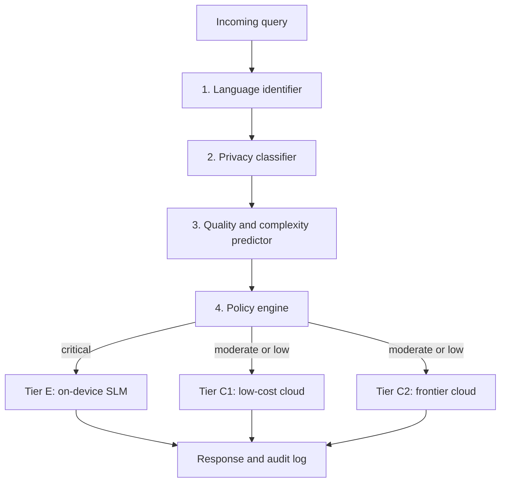

# Multilingual Helpdesk Model Router

A router that picks, for each helpdesk query, the most suitable language model by balancing **cost**, **latency**, and **privacy**, with explicit support for multiple languages.

> **Status:** Design and evaluation protocol. The router is not yet implemented, and no experimental results are reported yet. See [Roadmap](#roadmap).

---

## Table of Contents

- [Motivation](#motivation)
- [How It Works](#how-it-works)
- [Model Tiers](#model-tiers)
- [Routing Policy](#routing-policy)
- [Planned Evaluation](#planned-evaluation)
- [Repository Structure](#repository-structure)
- [Getting Started](#getting-started)
- [Roadmap](#roadmap)
- [Related Work](#related-work)
- [Citation](#citation)
- [License](#license)

---

## Motivation

Helpdesk assistants that serve multilingual users face a three-way trade-off:

| Strategy | Quality | Cost | Latency | Privacy | Lower-resource languages |
|---|---|---|---|---|---|
| Always use the frontier cloud model | High | High | High | Data leaves the device | Varies |
| Always use a small local model | Lower on complex queries | Low | Low | Data stays local | Often weaker |
| **This router** | Close to frontier where needed | Reduced | Reduced | Critical data stays local | Corrected per language |

Existing routing methods such as FrugalGPT, Hybrid LLM, AutoMix, and RouteLLM optimize cost and quality. None of them treats privacy as a hard constraint, models latency explicitly, or corrects for language differences. This project aims to address all four objectives in one routing policy.

## How It Works



1. **Language identifier** detects the query language and script. Mixed-language queries are tagged with a primary language.
2. **Privacy classifier** assigns a sensitivity level (low, moderate, or critical). Structured identifiers (phone numbers, account numbers) are caught by pattern detectors, and free-text sensitive content is caught by a multilingual classifier. When the two disagree, the higher level is used.
3. **Quality and complexity predictor** estimates the probability that each tier's answer will be judged acceptable, using multilingual query embeddings, the detected language, and query length.
4. **Policy engine** applies the privacy filter, then selects the tier that maximizes the utility function described below.

## Model Tiers

| Tier | Description | Data leaves device? |
|---|---|---|
| **E** | Small language model on the user's device or an on-premise server | No |
| **C1** | Low-cost hosted model | Yes |
| **C2** | Frontier hosted model | Yes |

Specific models and version identifiers will be fixed during setup and recorded with the results.

## Routing Policy

**Step 1: Privacy filter (hard constraint)**

| Privacy level | Admissible tiers |
|---|---|
| Critical | E only. If E cannot answer, return a fallback message. No cloud call. |
| Moderate | E, plus C1 or C2 only where a data-processing contract applies |
| Low | E, C1, C2 |

**Step 2: Utility maximization (soft objectives)**

For each admissible tier *t*:

```
U(t) = Q'(t | x, lang) − λ · cost(t, x) − μ · latency(t)
```

- `Q'` is the predicted probability of an acceptable answer, corrected by a per-language penalty
- `cost` and `latency` are normalized to [0, 1]
- `λ` and `μ` are operator-set weights

The router selects `argmax U(t)` over the admissible tiers.

**Step 3: Language-aware correction**

```
Q'(t | x, lang) = max(0, Q(t | x, lang) − δ(t, lang))
```

The penalty `δ` is learned on a validation set, so the router does not send lower-resource-language queries to a weak tier just because it is cheap.

## Planned Evaluation

The evaluation compares the proposed router against four systems:

| Code | System |
|---|---|
| B1 | Always on-device |
| B2 | Always frontier cloud |
| B3 | Rule-based (language and keywords) |
| B4 | Cost-only learned router (RouteLLM-style) |

**Metrics**

- Cost per resolved query
- p50 and p95 end-to-end latency, including routing overhead
- Privacy violation rate (target: 0%)
- Answer quality (fraction judged acceptable)
- Language fairness gap (difference between the highest- and lowest-resource languages)
- Routing overhead

**Ablations:** remove the privacy filter, remove the language correction, and sweep the weights `λ` and `μ`.

Results will be added to this README once experiments are complete.

## Repository Structure

The planned layout is shown below. Directories marked *(planned)* do not exist yet.

```
.
├── README.md
├── docs/
│   ├── 1_Abstract.docx                            # project abstract
│   ├── 2_Literature_Survey.docx                   # related work and research gap
│   ├── 3_Research_Paper_1_System_Design.docx      # architecture and routing policy
│   └── 4_Research_Paper_2_Evaluation.docx         # evaluation protocol
├── router/          (planned)                     # language, privacy, quality, policy modules
├── gateway/         (planned)                     # OpenAI-compatible API layer
├── data/            (planned)                     # query sets and labels (no personal data)
├── experiments/     (planned)                     # baselines, ablations, and analysis scripts
└── LICENSE
```

## Getting Started

The implementation is not yet available, so there is nothing to install or run. This section will be completed when the router is released. The intended setup is:

```bash
git clone <repository-url>
cd <repository-name>
pip install -r requirements.txt      # planned
python -m router.serve               # planned: start the OpenAI-compatible gateway
```

## Roadmap

- [x] Literature review and research gap analysis
- [x] System design and routing policy
- [x] Evaluation protocol
- [ ] Language identification and privacy classification modules
- [ ] Quality predictor trained on labeled data
- [ ] Routing policy and OpenAI-compatible gateway
- [ ] Baseline runs (B1 to B4)
- [ ] Full evaluation and ablations
- [ ] Results and final report

## Related Work

- Chen, L., Zaharia, M., & Zou, J. (2023). *FrugalGPT.* arXiv:2305.05176.
- Ding, D. et al. (2024). *Hybrid LLM: Cost-efficient and quality-aware query routing.* ICLR 2024. arXiv:2404.14618.
- Madaan, A. et al. (2024). *AutoMix: Automatically mixing language models.* NeurIPS 2024. arXiv:2310.12963.
- Ong, I. et al. (2025). *RouteLLM: Learning to route LLMs with preference data.* ICLR 2025. arXiv:2406.18665.
- Petrov, A. et al. (2023). *Language model tokenizers introduce unfairness between languages.* NeurIPS 2023. arXiv:2305.15425.
- Ahia, O. et al. (2023). *Do all languages cost the same? Tokenization in the era of commercial language models.* EMNLP 2023. arXiv:2305.13707.
- Shi, F. et al. (2023). *Language models are multilingual chain-of-thought reasoners.* ICLR 2023. arXiv:2210.03057.
- Zhan, J., Shen, H., Lin, Z., & He, T. (2026). *PRISM: Privacy-aware routing for adaptive cloud–edge LLM inference via semantic sketch collaboration.* AAAI 2026. arXiv:2511.22788.

## Citation

If you use this design or evaluation protocol, please cite it as:

```bibtex
@misc{multilingual-helpdesk-router,
  title  = {Multilingual Helpdesk Model Router Based on Cost, Latency and Privacy},
  author = {[Student Name]},
  year   = {[Year]},
  note   = {Design and evaluation protocol; implementation in progress}
}
```

## License

[Choose a license, for example MIT or Apache-2.0, and add a LICENSE file.]
